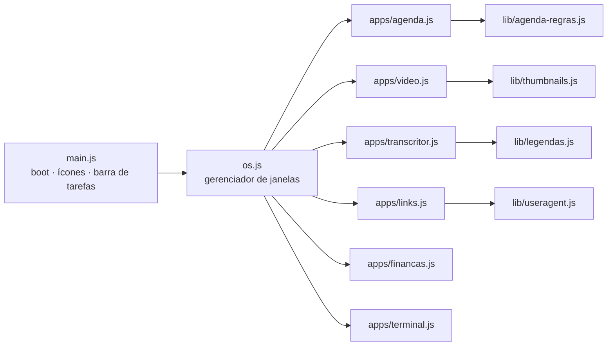

<h1 align="center">🖥️ Weslei OS</h1>

<p align="center">
  <b>Meu portfólio em forma de sistema operacional — direto no navegador.</b><br>
  Cada app da área de trabalho é uma versão interativa de um projeto real do meu GitHub.
</p>

<p align="center">
  <a href="https://joseweslei45-debug.github.io/weslei-os/"><b>🚀 Abrir o Weslei OS</b></a>
</p>

<p align="center">
  
  
  
  
</p>

---

## ✨ O que tem dentro

| App | Integra o projeto | O que dá para fazer |
|-----|------------------|---------------------|
| 📅 **Agenda Inteligente** | [agenda-inteligente-api](https://github.com/joseweslei45-debug/agenda-inteligente-api) | Agendar horários com as mesmas regras da API Java (conflitos, almoço, antecedência) e usar a **máquina do tempo** para testar o prazo de cancelamento |
| 🎬 **Video Pipeline** | [video-pipeline](https://github.com/joseweslei45-debug/video-pipeline) | Soltar vídeos numa **fila com 1 a 4 workers**, ver o kanban andar, retentativas com backoff e baixar as thumbnails. Sem vídeo? O app **grava um vídeo de exemplo** na hora |
| 🎙️ **Transcritor** | [transcritor-local](https://github.com/joseweslei45-debug/transcritor-local) | Falar no microfone e ver **legendas ao vivo**, exportando em SRT/VTT/TXT |
| 🔗 **Link Lab** | [encurtador-url-metricas](https://github.com/joseweslei45-debug/encurtador-url-metricas) | Ver o **raio-x do seu próprio clique** e encurtar links com painel de métricas |
| 💰 **Finanças** | [dashboard-financas](https://github.com/joseweslei45-debug/dashboard-financas) | O dashboard completo, embutido numa janela |
| ⌨️ **Terminal** | — | Um shell com `help`, `projetos`, `abrir agenda`, `neofetch`... e alguns segredos |

Links diretos para cada app: `#agenda`, `#video`, `#transcritor`, `#links`, `#financas`, `#terminal` — ex.: [weslei-os/#video](https://joseweslei45-debug.github.io/weslei-os/#video).

## 🧠 Como funciona



- **Gerenciador de janelas próprio**: arrastar (Pointer Events), redimensionar, minimizar, maximizar, foco por z-index e barra de tarefas — sem nenhuma biblioteca.
- **Lógica portada, não reescrita do zero**: os arquivos em `js/lib/` são traduções diretas das regras dos projetos originais (Java, Node e Python) e têm **testes automatizados** com `node --test`.
- **Cada app é um módulo** com `{ id, titulo, icone, montar() }`. O `montar` devolve uma função de limpeza (parar microfone, liberar URLs de vídeo) chamada ao fechar a janela.
- **APIs do navegador** usadas de verdade: `MediaRecorder` + `canvas.captureStream` (gerar vídeo), `<video>` + `canvas` (extrair frames), `SpeechRecognition` (transcrição), `crypto.subtle` (hash do visitante), `crypto.getRandomValues` (códigos base62).

## 🚀 Rodando localmente

```bash
npx serve .          # ou: python -m http.server 8000
npm test             # testes das regras portadas
```

> Abra pelo servidor local — módulos ES não funcionam via `file://`.

## 📁 Estrutura

```
index.html
css/os.css
js/
├── main.js          # boot, área de trabalho, menu iniciar, relógio
├── os.js            # gerenciador de janelas
├── projetos.js      # dados dos projetos
├── apps/            # um arquivo por app
└── lib/             # regras portadas dos projetos originais (testadas)
test/
```

---
Feito por [Weslei Sousa](https://github.com/joseweslei45-debug) em Quixadá, Ceará 🇧🇷 · Licença MIT
